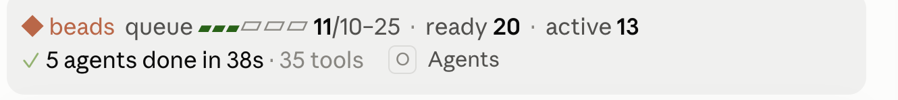
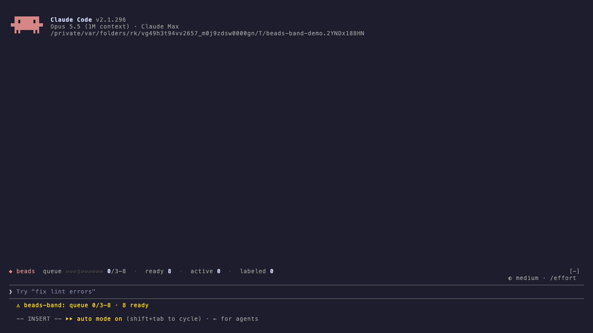

# beads-band

[](https://github.com/algonormative/beads-band/actions/workflows/ci.yml)
[](https://github.com/algonormative/beads-band/releases/latest)
[](LICENSE)
[](#install)
[](https://code.claude.com/docs/en/plugins/mods/overview)
[](#install)

A band above the Claude Code prompt for [beads](https://github.com/gastownhall/beads) task queues, read through the `br` CLI ([beads_rust](https://github.com/Dicklesworthstone/beads_rust)).

While you're idle it shows the queue:


```
◆ beads  queue ▰▰▰▰▱▱▱▱▱▱ 9/10–25  ·  ready 20  ·  active 3  ·  labeled 12
```

Once this session claims a task, the band switches to that task:

```
▶ proj-3by8d  webapp: prove one raster-guided artwork as a standalone sketch
  P2 · task · webapp · claimed 12m ago   │   queue 9  ·  ready 20
```

- **queue**: ready tasks carrying the queue label (default `autonomy:safe`), drawn as a meter against your target range. The `▯` cell marks the low end of the target. The fill is the accent color below the target and the success color at or above it.
- **ready / active / labeled**: `br ready`, tasks in progress, and every open task carrying the queue label.
- **Width tiers**: narrow terminals get a shorter line (`◆ 9/10 queued · ready 20`) that clips instead of wrapping.
- **Colors** come from your Claude Code theme keys (`claude`, `success`, `inactive`, `subtle`, `suggestion`), so the band follows whatever theme you use.

## When the band switches to a task

The band shows a task once a Bash command in this session runs `br update <id>` with `--claim`, `-s in_progress` or `--status=in_progress`, and the command succeeds. It switches back to the queue when this session runs `br close <id>` or sets that task to any other status. Tasks claimed in other sessions or terminals never take over the band.

It shares the space above the prompt with other mods' bands. Here it sits above [subagents-plus](https://github.com/algonormative/subagents-plus):



In a terminal session, claiming a task switches the band over ([demo/demo.tape](demo/demo.tape), recorded with [VHS](https://github.com/charmbracelet/vhs)):



## Install

In a Claude Code terminal session, from the algonormative marketplace (add it once):

```
/plugin marketplace add algonormative/claude-plugins
/plugin install beads-band@algonormative
```

Or from this repository alone:

```
/plugin install beads-band --marketplace algonormative/beads-band
```

Answer `y` to add the marketplace, then pick a scope. The band appears above the prompt the next time a session starts in a directory with a `.beads/` folder.

## Configure

Set these in `/config`, or in `~/.claude/settings.json` under `pluginConfigs["beads-band@beads-band"].options`:

| Option | Default | What it does |
|---|---|---|
| `beadsDir` | session directory | Absolute path of the checkout whose `.beads/` the band reads |
| `queueLabel` | `autonomy:safe` | Label that marks tasks as queued for automation |
| `queueCommand` | none | A command (run without a shell) that prints a JSON array of eligible tasks; replaces `br ready --label <queueLabel>` when your eligibility rules are stricter |
| `refreshMinutes` | `5` | How often the band refreshes in the background (it also refreshes after turns and after any `br update`/`br close`) |
| `targetMin` / `targetMax` | `10` / `25` | The target range the meter is drawn against |

Commands: `/beads-band` refreshes and prints a one-line summary. `/beads-band hide` and `/beads-band show` toggle the band.

## Develop

This is a Claude Code hooks module (`hooks/register.tsx`). Run the tests with:

```
claude plugin test .
claude plugin validate .
```

The tests stub `br`, so they never read a real queue.

## License

MIT
